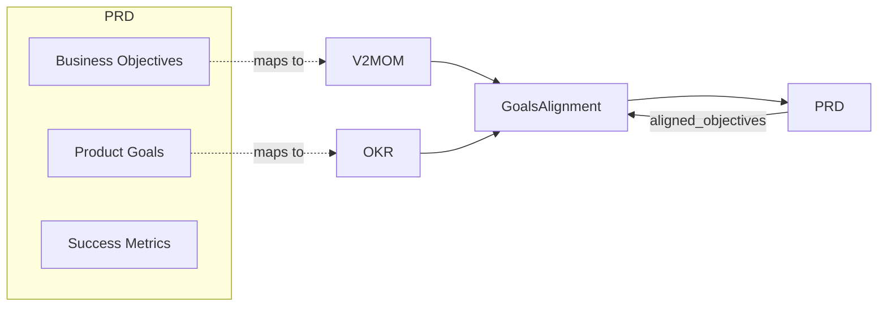

# Goals Integration Overview

PRISM Execution supports alignment with strategic goal frameworks.

## Supported Frameworks

| Framework | Description | Best For |
|-----------|-------------|----------|
| **V2MOM** | Vision, Values, Methods, Obstacles, Measures | Company/team strategic planning |
| **OKR** | Objectives and Key Results | Quarterly goal setting |
| **VSEM** | Vision, Strategy, Execution, Metrics | A one-page plan with resources and accountable owners |
| **OGSM** | Objective, Goals, Strategies, Measures | One objective with goals in numbers and measures per strategy |
| **Balanced Scorecard** | Perspectives, objectives, strategy map, measures, initiatives | A strategy balanced across financial, customer, process, and capability views |

`goals/dmaic` (DMAIC metrics documents) and `goals/mel` (monitoring,
evaluation, and learning plans) sit beside these plans; see the kinds below.

## Kinds of Frameworks

The frameworks come from different organizations and answer different
questions. They fall into three kinds:

| Kind | Answers | Frameworks |
|------|---------|------------|
| **Strategy plans** | What do we want to achieve, how, and how will we know? | OKR, V2MOM, VSEM, OGSM, Balanced Scorecard |
| **Improvement plans** | How do we move one process metric from a baseline to a target, and hold it there? | DMAIC |
| **Measurement and learning plans** | How will results be measured, evaluated, and learned from? | MEL |

The strategy plans differ in how much cause and effect they record. OKR,
V2MOM, and VSEM list goals and measures without saying how one leads to
another; OGSM links each strategy to the goals it serves; the Balanced
Scorecard's strategy map links objectives from cause to effect across its
perspectives; and a MEL plan's results framework does the same for outcomes.
A full causal model of how change happens, such as a theory of change or a
logic model, goes further: it records the assumptions behind each link and the
evidence for it. Such a model can be drawn as any of these plans.

| Framework | Origin |
|-----------|--------|
| OKR | Andy Grove at Intel in the 1970s, building on Peter Drucker's management by objectives; brought to Google by John Doerr in 1999 |
| V2MOM | Marc Benioff at Salesforce |
| VSEM | Cisco, extending its Vision, Strategy, and Execution with Metrics |
| OGSM | Popularized by Procter & Gamble, with claimed roots in postwar Japan |
| Balanced Scorecard | Robert Kaplan and David Norton, *Harvard Business Review*, 1992; strategy maps followed in 2000 |
| DMAIC | Six Sigma, developed at Motorola and spread by General Electric |
| MEL | International development practice, such as USAID's program cycle guidance |

## Why Integrate Goals?

Connecting PRDs to strategic goals provides:

- **Traceability** - Link features to business objectives
- **Alignment** - Ensure work supports company strategy
- **Prioritization** - Use goal priority to guide decisions
- **Measurement** - Connect success metrics to KRs

## Integration Architecture



## GoalsAlignment Structure

```go
type GoalsAlignment struct {
    // Reference external V2MOM
    V2MOMRef *GoalReference `json:"v2mom_ref,omitempty"`

    // Embed V2MOM directly
    V2MOM *v2mom.V2MOM `json:"v2mom,omitempty"`

    // Reference external OKR
    OKRRef *GoalReference `json:"okr_ref,omitempty"`

    // Embed OKR directly
    OKR *okr.OKRDocument `json:"okr,omitempty"`

    // Map PRD objectives to goal IDs
    AlignedObjectives map[string]string `json:"aligned_objectives,omitempty"`
}
```

## Two Integration Modes

### 1. Reference Mode

Link to external goal documents:

```go
doc.Goals = &prd.GoalsAlignment{
    V2MOMRef: &prd.GoalReference{
        ID:      "V2MOM-FY2025",
        Path:    "../goals/fy2025-v2mom.json",
        Version: "1.0.0",
    },
    AlignedObjectives: map[string]string{
        "BO-1": "method-1",  // Business Objective -> V2MOM Method
        "BO-2": "method-3",
    },
}
```

### 2. Embedded Mode

Include goals directly in PRD:

```go
doc.Goals = &prd.GoalsAlignment{
    OKR: &okr.OKRDocument{
        Objectives: []okr.Objective{
            {
                ID:    "O1",
                Title: "Improve customer retention",
                KeyResults: []okr.KeyResult{
                    {Title: "Reduce churn to <5%", Target: "5%"},
                },
            },
        },
    },
    AlignedObjectives: map[string]string{
        "PG-1": "O1",  // Product Goal -> OKR Objective
    },
}
```

## Alignment Mapping

The `AlignedObjectives` map connects PRD items to goals:

| PRD Item | Maps To |
|----------|---------|
| Business Objective | V2MOM Method or OKR Objective |
| Product Goal | V2MOM Method or OKR Objective |
| Success Metric | V2MOM Measure or OKR Key Result |

```go
AlignedObjectives: map[string]string{
    "BO-1":  "method-1",    // -> V2MOM Method
    "PG-1":  "O1",          // -> OKR Objective
    "SM-1":  "KR-1",        // -> OKR Key Result
}
```

## Framework Comparison

| Aspect | V2MOM | OKR | VSEM | Balanced Scorecard |
|--------|-------|-----|------|--------------------|
| **Scope** | Annual/multi-year | Quarterly | Annual or a planning period | Annual or multi-year |
| **Structure** | 5 components | 2 components | 4 components | Perspectives, objectives, measures, initiatives |
| **Scoring** | Optional | 0.0-1.0 standard | Optional progress | Stoplight thresholds and progress |
| **Hierarchy** | Methods → Measures | Objectives → Key Results | Strategies → Execution and Metrics | Perspectives → Objectives → Measures |
| **Cause and effect** | Not included | Not included | Not included | A strategy map |
| **Values** | Explicit | Not included | Not included | Not included |
| **Obstacles** | Explicit | Track as risks | Not included | Not included |
| **Resources** | Not included | Not included | Committed per strategy | A budget per initiative |
| **Accountability** | Owners on methods | Owners on objectives | An owner on every metric | Owners on objectives, measures, and initiatives |

## Choosing a Framework

**Use V2MOM when:**

- Setting company or team annual strategy
- Need to define values and principles
- Want to track obstacles explicitly
- Prefer Salesforce-style planning

**Use OKR when:**

- Setting quarterly goals
- Need standardized scoring (0.0-1.0)
- Want lightweight goal tracking
- Prefer Google-style planning

**Use VSEM when:**

- The plan has to fit on one page
- You need to say where people and money go for each strategy
- Every metric needs a named owner

**Use OGSM when:**

- The plan has one overriding objective for the next few years
- You want goals for the objective kept apart from measures for each strategy
- Plans cascade, each team's objective being a strategy of the level above

**Use the Balanced Scorecard when:**

- Financial results alone would hide what drives them
- You want the cause and effect between objectives drawn as a strategy map
- Measures should mix lead indicators with lag results

**Use both when:**

- V2MOM for annual strategy
- OKR for quarterly execution

## Installation

```bash
go get github.com/grokify/prism-roadmap
```

```go
import (
    "github.com/grokify/prism-roadmap/requirements/prd"
    "github.com/grokify/prism-roadmap/goals/v2mom"
    "github.com/grokify/prism-roadmap/goals/okr"
    "github.com/grokify/prism-roadmap/goals/vsem"
    "github.com/grokify/prism-roadmap/goals/bsc"
)
```

A PRD's `goals` alignment block embeds a V2MOM or OKRs. To align a PRD with a
VSEM, set `ProductGoals` to `goals.NewVSEM(v)`: roadmap tables then label goals
"Strategies" and results "Metrics". `goals.NewOGSM(o)` does the same for an
OGSM, with results labelled "Goals and Measures", and `goals.NewBSC(b)` for a
Balanced Scorecard, with goals labelled "Objectives" and results "Measures".

## Next Steps

- [V2MOM Integration](v2mom.md)
- [OKR Integration](okr.md)
- [VSEM Integration](vsem.md)
- [OGSM Integration](ogsm.md)
- [Balanced Scorecard Integration](bsc.md)
- [DMAIC Integration](dmaic.md)
- [MEL Plans](mel.md)
