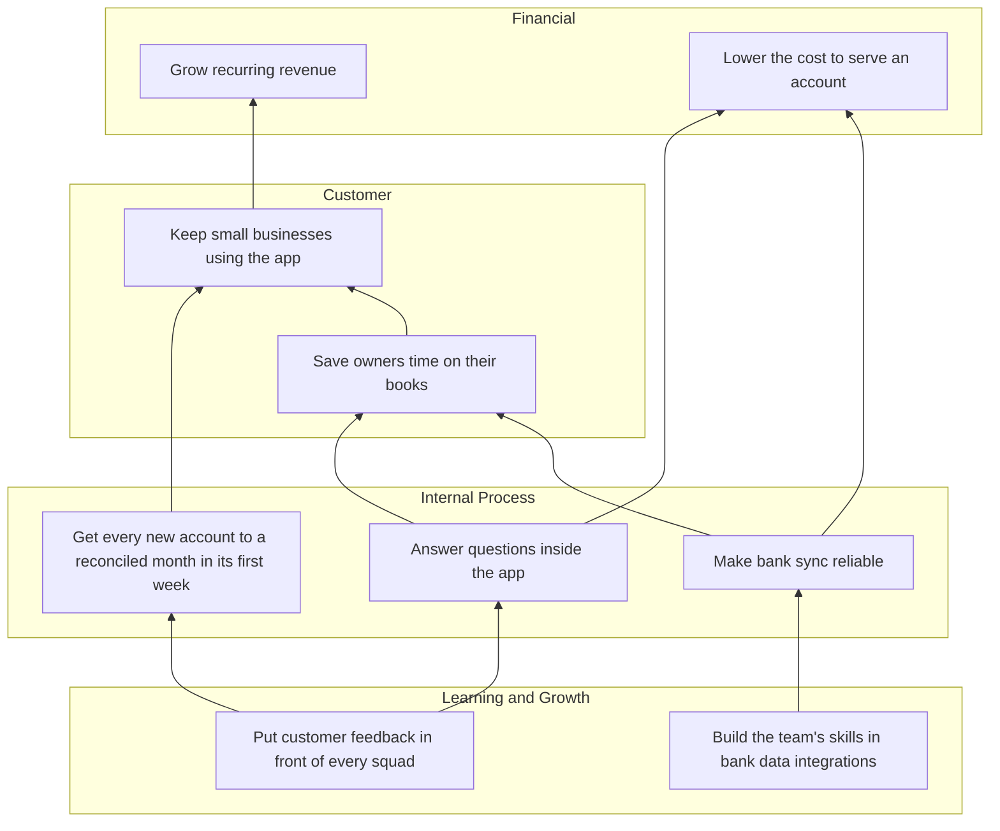

# Bookkeeping App Balanced Scorecard FY2027

**Team:** Bookkeeping App · **Period:** FY2027 · **Author:** Strategy Office · **Status:** Active · **Version:** 1.0

## Mission, Vision, and Strategy

**Mission:** Give small business owners books they can trust without becoming bookkeepers

**Vision:** The bookkeeping app small businesses keep using

**Strategy:** Win on retention, not acquisition: get each new account to a reconciled month fast, keep bank data flowing without help, and answer questions before they become tickets.

## Strategy Map

Each arrow runs from an objective to one it helps achieve.

## Strategic Themes

| Theme | Owner | Objectives |
|-------|-------|------------|
| Retention Accounts that reach a reconciled month early stay. | Head of Product | Grow recurring revenue; Keep small businesses using the app; Get every new account to a reconciled month in its first week; Put customer feedback in front of every squad |
| Efficiency Reliable data and self-service lower the cost to serve an account. | Head of Operations | Lower the cost to serve an account; Save owners time on their books; Make bank sync reliable; Answer questions inside the app; Build the team's skills in bank data integrations |

## Scorecard

### Financial

*To succeed financially, how should we appear to those who fund us?*

| Objective | Measure | Type | Owner | Baseline | Target | Current | Status |
|-----------|---------|------|-------|----------|--------|---------|--------|
| Grow recurring revenue Owner: Chief Financial Officer | Annual recurring revenue | lag | Chief Financial Officer | 4.2 million USD | 6.0 million USD | 4.6 million USD | On Track |
| Lower the cost to serve an account Owner: Chief Financial Officer | Support and hosting cost per active account per month | lag | Head of Operations | 3.10 USD | 2.40 USD | 2.95 USD | At Risk |

### Customer

*To achieve our vision, how should we appear to our customers?*

| Objective | Measure | Type | Owner | Baseline | Target | Current | Status |
|-----------|---------|------|-------|----------|--------|---------|--------|
| Keep small businesses using the app Owner: Head of Product | Accounts still active at 90 days | lag | Head of Product | 52% | 65% (green at 63%, red at 55%) | 56% | On Track |
| Save owners time on their books Owner: Head of Product | Hours an owner spends closing a month | lag | Head of Product | 6 hours | 2 hours | 5 hours | On Track |

### Internal Process

*To satisfy our customers, which processes must we excel at?*

| Objective | Measure | Type | Owner | Baseline | Target | Current | Status |
|-----------|---------|------|-------|----------|--------|---------|--------|
| Get every new account to a reconciled month in its first week Owner: Head of Onboarding | New accounts with a reconciled month in their first week | lead | Head of Onboarding | 18% | 40% (green at 35%, red at 20%) | 24% | On Track |
| Make bank sync reliable Owner: Head of Platform | Bank syncs that complete without help | lead | Head of Platform | 93% | 99% | 94% | Behind |
| Answer questions inside the app Owner: Head of Support | Questions answered in the app without a ticket | lead | Head of Support | 30% | 55% | 36% | On Track |

### Learning and Growth

*To excel at those processes, how will we sustain our ability to change and improve?*

| Objective | Measure | Type | Owner | Baseline | Target | Current | Status |
|-----------|---------|------|-------|----------|--------|---------|--------|
| Build the team's skills in bank data integrations Owner: Head of Engineering | Engineers certified on the bank data platform | lead | Head of Engineering | 4 engineers | 12 engineers | 6 engineers | On Track |
| Put customer feedback in front of every squad Owner: Head of Research | Squads that review customer feedback every sprint | lead | Head of Research | 2 squads | 6 squads | 3 squads | On Track |

## Initiatives

| Initiative | Objectives | Owner | Timing | Budget | Status |
|------------|------------|-------|--------|--------|--------|
| Ship guided bank import | Get every new account to a reconciled month in its first week; Keep small businesses using the app | Onboarding squad | 2027-01-04 to 2027-03-26 | 2 engineers for a quarter | In Progress |
| Rebuild the bank sync pipeline | Make bank sync reliable; Save owners time on their books; Lower the cost to serve an account | Platform squad | 2027-02-01 to 2027-09-30 | 4 engineers for three quarters | In Progress |
| Put answers to the top 50 questions inside the app | Answer questions inside the app; Lower the cost to serve an account | Support Operations | 2027-03-01 to 2027-06-30 |  | Planned |
| Run a bank data integration academy | Build the team's skills in bank data integrations | Engineering Enablement | 2027-01-11 to 2027-04-30 |  | In Progress |
| Rotate each squad through customer calls | Put customer feedback in front of every squad | Research team | from 2027-01-04 |  | In Progress |
| Offer annual plans | Grow recurring revenue | Growth team | 2027-04-01 to 2027-05-31 |  | Planned |
